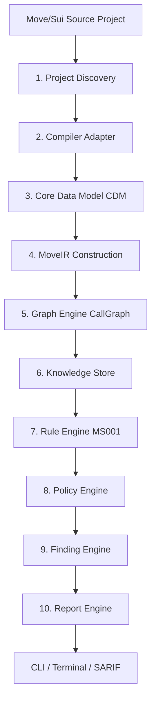

# MoveShield Architecture & Engines Documentation

Welcome to the comprehensive MoveShield architecture documentation. This document is designed for developers, architects, and security engineers who want to understand, build, and extend the MoveShield static analysis platform.

---

## 1. Overall Scan Pipeline

MoveShield operates as a multi-stage compilation and static analysis pipeline. The process is completely unidirectional, deterministic, and modularized into distinct Cargo crates.



Each module has a strict downward dependency constraint adhering to `RFC-0020`. No higher-level engine can call or depend on a lower-level engine directly without following this pipeline.

---

## 2. Core Engines & Architectural Components

### 2.1 Project Discovery (`moveshield-compiler::discovery`)
- **Responsibility:** Scans the target workspace or folder for a valid Move package.
- **Workflow:** Locates `Move.toml`, extracts package metadata (e.g., package name, version, and declared named addresses), and crawls the `sources/` directory recursively to collect all Move source code files (`.move`).

### 2.2 Compiler Adapter (`moveshield-compiler::adapter`)
- **Responsibility:** Defines the stable trait boundary `CompilerAdapter` to isolate compiler toolchains from our core data model.
- **Development Parser Fallback:** When the official Move compiler is not available on the local machine, a lightweight fallback parser tokenizes and parses the `.move` sources to extract modules, structures, fields, and functions. This ensures that developers can run and test analyses even without a fully set-up blockchain compiler toolchain.

### 2.3 Core Data Model (CDM) (`moveshield-core`)
- **Responsibility:** Holds the canonical representation of a scanned project.
- **Entities:**
  - `Project`: Root of the scanned package.
  - `Package`: Repositories or specific sub-packages of Move.
  - `Module`: Identifiers, addresses, and physical source files.
  - `Struct` & `Field`: Struct layout, abilities (key, store, copy, drop), and fields.
  - `Function`: Complexity, visibility (private, public, entry, public(friend)), parameters/calls, and location info.
  - `Finding`: Raw warnings, severities (Critical, High, Medium, Low, Informational), and suggested fixes.

### 2.4 MoveIR (`moveshield-ir`)
- **Responsibility:** Decoupled semantic intermediate representation optimized for static analysis.
- **Design:** Translates CDM structures into maps indexed by fully-qualified IDs (`address::module::function`), which allows rapid lookup and traversal without recursively searching through packages and lists.

### 2.5 Graph Engine (`moveshield-graph`)
- **Responsibility:** Constructs and traverses complex relationships, currently building the **Call Graph**.
- **Capabilities:**
  - Resolves fully qualified and short-form function calls.
  - Detects recursion (cycles where a function can path back to itself).
  - Identifies entry points (functions marked with `entry`).
  - Identifies unused functions (functions with no incoming calls, excluding `entry` and standard `init` routines).

### 2.6 Knowledge Store (`moveshield-knowledge`)
- **Responsibility:** A centralized database containing factual analysis state.
- **Separation of Concerns:** Houses facts and relationships (like the Call Graph and function complexity metrics) but does not make decisions on whether they constitute a vulnerability or code smell.

### 2.7 Rule Engine (`moveshield-rules`)
- **Responsibility:** Contains modular logic checks called rules that implement the `Rule` trait.
- **Process:** Rules query the factual facts from the `KnowledgeStore` and evaluate them based on user configurations to produce raw Findings.

### 2.8 Policy Engine (`moveshield-policy`)
- **Responsibility:** Applies organization-wide profiles, finding filters, suppression rules, and severity overrides. It acts as the threshold turning factual anomalies into reportable security violations.

### 2.9 Finding Engine (`moveshield-findings`)
- **Responsibility:** Deduplicates redundant findings and enforces a deterministic sort order (by rule ID, source file, line, and column) to ensure scans are reproducible and clean.

### 2.10 Report Engine (`moveshield-report`)
- **Responsibility:** Generates human-friendly Terminal summaries, standard JSON, and highly detailed, industry-compliant **SARIF 2.1.0** static analysis files saved to `./moveshield.sarif` outside the project directory.

---

## 3. CLI Execution Flow

The CLI (`apps/cli`) executes the entire platform loop sequentially:

```
[CLI Startup]
      │
      ▼
[Load Configuration] (Load moveshield.toml, exit 3 on configuration error)
      │
      ▼
[Disover Project]    (Extract package meta & .move sources, exit 1 on discovery error)
      │
      ▼
[Compile / Parse]    (Invoke Compiler Adapter / Development Parser fallback)
      │
      ▼
[Construct MoveIR]   (Convert Core Data Model into MoveIR maps)
      │
      ▼
[Build CallGraph]    (Build edges, resolve qualified/unqualified call sites)
      │
      ▼
[Assemble Knowledge] (Assemble CallGraph and metrics into KnowledgeStore)
      │
      ▼
[Execute Rules]      (Run MS001 Cyclomatic Complexity rule with configuration)
      │
      ▼
[Apply Policy]       (Filter findings, suppress overrides via PolicyEngine)
      │
      ▼
[Deduplicate]        (Deduplicate and sort findings via FindingEngine)
      │
      ▼
[Generate Reports]   (Print colored terminal summary & write moveshield.sarif)
      │
      ▼
[Decide Exit Code]   (Exit 0 for success/no findings, exit 2 for blocking findings)
```

---

## 4. MS001: Cyclomatic Complexity Rule Specification

### 4.1 How Cyclomatic Complexity is Computed
MoveShield uses an industry-standard control-flow calculation. A function starts with a base complexity score of **1**. The score is incremented by **1** for every occurrence of branching or logical control-flow constructs inside the function body:
- `if`
- `while`
- `loop`
- `&&` (Logical AND operator)
- `||` (Logical OR operator)

### 4.2 Non-Compliant Code Example
This function contains multiple branches, leading to a complexity score of **12**, exceeding the default limit of **10**:

```move
module example::complex {
    public fun transfer(
        amount: u64,
        is_frozen: bool,
        is_whitelisted: bool,
        sender_balance: u64
    ): bool {
        // Score starts at 1
        if (amount == 0) { return false; }; // +1 (if) = 2
        if (is_frozen) { return false; }; // +1 (if) = 3
        if (!is_whitelisted && amount > 1000) { return false; }; // +1 (if) +1 (&&) = 5
        if (sender_balance < amount) { return false; }; // +1 (if) = 6
        if (amount > 10000) { return false; }; // +1 (if) = 7
        if (amount % 2 == 1) { }; // +1 (if) = 8
        if (sender_balance - amount < 100) { return false; }; // +1 (if) = 9
        if (amount == 500) { }; // +1 (if) = 10
        if (sender_balance >= amount + 10) { return true; }; // +1 (if) = 11
        if (amount == 999) { return false; }; // +1 (if) = 12
        true
    }
}
```

### 4.3 Compliant Code Example
This function breaks down complex rules into a helper function, keeping complexity well under the threshold:

```move
module example::clean {
    public fun get_base_fee(): u64 {
        100 // Complexity = 1
    }

    public fun calculate_fee(amount: u64): u64 {
        amount + get_base_fee() // Complexity = 1
    }
}
```

---

## 5. Architectural Decisions & Trade-Offs (ADR)

### 5.1 Decoupled Core Data Model & IR
- **Decision:** Separate the `Core Data Model (CDM)` from the `MoveIR`.
- **Reasoning:** The compiler adapter generates the flat, structural CDM. Translating it to MoveIR indexes code elements into logical lookup trees. This keeps compilation decoupling perfect and analysis lookups fast.
- **Trade-off:** Minimal memory overhead for maintaining two representations during analysis, which is negligible for the scale of typical Move smart contracts.

### 5.2 Lightweight Development Parser Fallback
- **Decision:** Write an isolated fallback regex-free state parser (`DevelopmentParserAdapter`) when official toolchains are missing.
- **Reasoning:** Ensures immediate developer onboarding and running tests out-of-the-box.
- **Limitations:** Does not fully resolve generic types, type aliases, or complex nested macro checks. It is intended for initial pipeline bootstrapping; the official compiler toolchain should be utilized for absolute type and reference resolution.

### 5.3 Immutable Graphs & Fact Stores
- **Decision:** Graphs and facts are fully constructed and frozen before rules run.
- **Reasoning:** Eliminates concurrency race conditions, simplifies rule writing, and prevents rules from dynamically altering facts or corrupting other rules' analyses.

---

## 6. How to Add a New Rule (Developer Extension Guide)

To implement a new static analysis rule in MoveShield, follow these steps:

1. **Define the Rule in `crates/moveshield-rules/src/rules/`**
   Create a new file, e.g., `crates/moveshield-rules/src/rules/ms002.rs`. Enforce the rule structure and implement the `Rule` trait:

   ```rust
   use moveshield_core::models::{Finding, Confidence, Severity, RuleCategory};
   use moveshield_knowledge::KnowledgeStore;
   use moveshield_config::Config;
   use crate::Rule;

   pub struct MS002;

   impl Rule for MS002 {
       fn id(&self) -> &'static str { "MS002" }
       fn name(&self) -> &'static str { "Unused Functions" }
       fn category(&self) -> RuleCategory { RuleCategory::Style }

       fn run(&self, store: &KnowledgeStore, config: &Config) -> Vec<Finding> {
           let mut findings = Vec::new();
           // Implement rule query here utilizing store.call_graph
           findings
       }
   }
   ```

2. **Register the Rule**
   - Register your rule module in `crates/moveshield-rules/src/rules.rs`.
   - Instantiate and run the rule inside the main execution loop in `apps/cli/src/main.rs`.

3. **Extend Config if Necessary**
   - Add custom config sections to `crates/moveshield-config/src/config.rs` inside `RulesConfig`.
